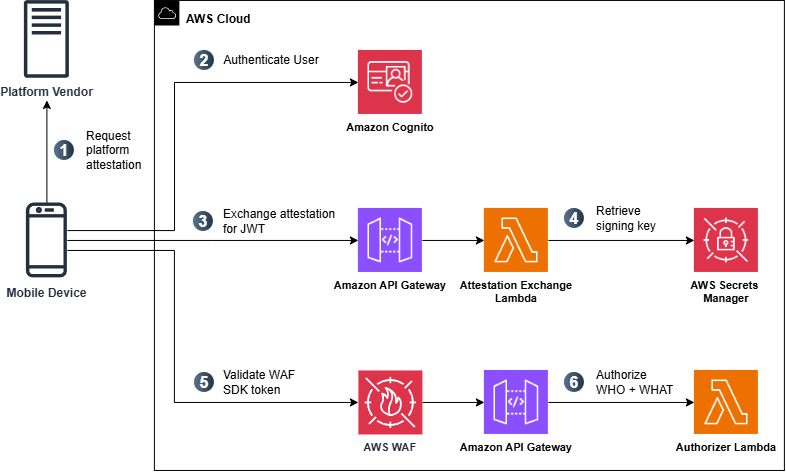

# Verifying mobile app integrity at the API layer using AWS serverless

> ⚠️ **This is a demo/reference implementation.** Play Integrity verification is **simulated** — the `verify_token()` function always returns a hardcoded passing verdict without making any network calls to Google. **Do not deploy this as-is in production.** See [Demo vs. Production](#demo-vs-production) for what you need to change.

This project is a **companion code repository** for the AWS Compute Blog post [Verifying mobile app integrity at the API layer using AWS serverless](https://aws.amazon.com/blogs/compute/verifying-mobile-app-integrity-api-layer-serverless/). It provides a deployable reference implementation of a layered verification system that validates both **user identity** (WHO — via Amazon Cognito) and **application integrity** (WHAT — via platform attestation) before granting access to protected API endpoints.

## Architecture



The architecture consists of the following components:

1. **Amazon Cognito** — User authentication and identity management (WHO)
2. **Google Play Integrity / Apple App Attest** — Platform attestation proving the app is legitimate and the device is uncompromised (WHAT)
3. **API Gateway (REST)** — API endpoint with a REQUEST-type Lambda authorizer
4. **Attestation Exchange Lambda** — Verifies platform attestation tokens and mints short-lived attestation JWTs
5. **Lambda Authorizer** — Dual-token validation (Cognito + attestation JWT) on protected routes
6. **Sample API Lambda** — Protected endpoint demonstrating the full attestation flow
7. **AWS Secrets Manager** — Stores the HMAC signing key for attestation JWT minting/verification

### Request Flow

1. **Request platform attestation** — The mobile app requests an integrity verdict from the platform vendor.
2. **Authenticate user** — The app authenticates the user through Amazon Cognito, returning short-lived OAuth tokens.
3. **Exchange attestation for JWT** — The app sends the platform attestation token to the `/attest` endpoint on Amazon API Gateway, routing the request directly to the Attestation Exchange Lambda.
4. **Retrieve signing key** — The Attestation Exchange Lambda retrieves a signing key from AWS Secrets Manager. The Lambda mints a short-lived attestation JWT and uses the key to sign the token before returning the JWT to the app.
5. **Validate WAF token** — On each API request, the mobile app includes a cryptographic cookie acquired by the AWS WAF Mobile SDK. The request passes through AWS WAF, which validates the token at the network edge before forwarding to Amazon API Gateway. Requests without a valid SDK token are blocked and never reach the gateway.
6. **Authorize WHO + WHAT** — Amazon API Gateway invokes the Lambda Authorizer, which evaluates both the Cognito access token and the attestation JWT. It verifies the Cognito token against JWKS and verifies the attestation JWT signature using the same Secrets Manager signing key. If either is missing, expired, or invalid, the authorizer returns a Deny policy and the client receives a 403 response.

## Demo vs. Production

This repository is a **demo reference implementation**. Here's what's simulated and what's real:

| Component | Demo behavior | Production behavior |
|-----------|--------------|---------------------|
| **Cognito authentication** | ✅ Real — actual Cognito User Pool, real token verification via JWKS | Same |
| **Play Integrity verification** | ⚠️ **Simulated** — `verify_token()` returns a hardcoded passing verdict | Calls `playintegrity.googleapis.com/v1/{project_id}:decodeIntegrityToken` |
| **Attestation JWT minting** | ✅ Real — HS256 JWT signed with Secrets Manager key | Same |
| **Lambda Authorizer** | ✅ Real — verifies both Cognito + attestation JWT signatures | Same |
| **AWS WAF** | ❌ Not included | Add WAF Web ACL with Bot Control and rate limiting |
| **Apple App Attest (iOS)** | ❌ Not implemented (platform field accepted but not verified) | Implement Apple DeviceCheck verification |

### What you'd change for production

1. **Replace `play_integrity.py` `verify_token()`** — Implement the real Google Play Integrity API call using the `requests` library to call `https://playintegrity.googleapis.com/v1/{project_id}:decodeIntegrityToken`. The `evaluate_verdict()` function already contains correct validation logic for checking Google's response.
2. **Configure Google Cloud credentials** — Set up a service account or use application default credentials for the Google API call.
3. **Add Apple App Attest** — For iOS support, implement a similar verification path using Apple's DeviceCheck framework.
4. **Add AWS WAF** — Attach a WAF Web ACL with Bot Control (Targeted) and rate limiting rules to the API Gateway stage for an additional defense layer.
5. **Remove `DEMO_MODE` env var** — Or implement conditional logic that uses it to switch between real and simulated verification.

## Prerequisites

- [AWS Account](https://aws.amazon.com/account/)
- [AWS SAM CLI](https://docs.aws.amazon.com/serverless-application-model/latest/developerguide/install-sam-cli.html) (v1.90+)
- [Python 3.13](https://www.python.org/downloads/)
- [AWS CLI](https://docs.aws.amazon.com/cli/latest/userguide/getting-started-install.html) configured with appropriate credentials

## Project Structure

```
├── src/
│   ├── attestation_exchange/   # POST /attest — verifies integrity token (simulated), mints attestation JWT
│   │   ├── app.py             # Lambda handler — orchestrates verification + JWT minting
│   │   ├── play_integrity.py  # ⚠️ DEMO: always returns passing verdict (replace for production)
│   │   ├── cognito_verifier.py # Verifies Cognito access tokens via JWKS
│   │   └── token_issuer.py    # Mints HS256-signed attestation JWTs
│   ├── authorizer/             # Lambda Authorizer — dual-token validation (Cognito + attestation)
│   └── sample_api/             # GET /protected — demo endpoint behind the authorizer
├── tests/
│   └── unit/                   # Unit + property-based tests (pytest + Hypothesis)
├── events/                     # Sample API Gateway event payloads for local testing
├── images/                     # Architecture diagram
├── scripts/                    # Helper scripts for end-to-end API testing
├── template.yaml               # SAM/CloudFormation template
├── samconfig.toml.example      # Example deployment configuration
├── requirements-dev.txt        # Development/test dependencies
├── LICENSE                     # MIT-0
├── CODE_OF_CONDUCT.md
├── CONTRIBUTING.md
└── README.md
```

## Cost

This project creates AWS resources that incur costs while deployed. The primary cost drivers are API Gateway, Lambda invocations, Cognito user pool, and Secrets Manager. For development/testing usage, costs are minimal (typically under $1/month within [Free Tier](https://aws.amazon.com/free/) limits). Remember to run `sam delete` when you're done to avoid ongoing charges.

## Quick Start

### Build

```bash
sam build
```

### Deploy

For first-time deployment, use the guided mode:

```bash
sam deploy --guided
```

This will prompt you for the following parameters:

| Parameter | Description |
|-----------|-------------|
| Stack Name | Name for the CloudFormation stack |
| AWS Region | Region to deploy to |
| Environment | Deployment environment (`dev`, `staging`, `prod`) |
| AttestationTokenTTLMinutes | JWT TTL in minutes (5–15, default: 10) |

For subsequent deployments:

```bash
sam deploy
```

## Testing

### Unit Tests

Install test dependencies and run the suite:

```bash
pip install -r requirements-dev.txt
pytest tests/ -v
```

All 142 tests should pass, covering property-based tests (Hypothesis) and standard unit tests.

### Local Testing with SAM CLI

Invoke a function locally using a sample event:

```bash
sam local invoke AttestationExchangeFunction --event events/attest_request.json
sam local invoke SampleApiFunction --event events/api_request.json
```

Start the full API locally:

```bash
sam local start-api
```

### Testing the Deployed API

After deployment, follow these steps to test the full end-to-end flow.

#### Step 1: Get Stack Outputs

```bash
aws cloudformation describe-stacks \
  --stack-name serverless-mobile-api-attestation \
  --query "Stacks[0].Outputs" \
  --output table
```

Save the values for `ApiEndpoint`, `CognitoUserPoolId`, and `CognitoAppClientId`.

#### Step 2: Enable USER_PASSWORD_AUTH for CLI Testing

The template uses SRP auth by default (more secure). For CLI-based testing, temporarily add password auth:

```bash
aws cognito-idp update-user-pool-client \
  --user-pool-id <CognitoUserPoolId> \
  --client-id <CognitoAppClientId> \
  --explicit-auth-flows ALLOW_USER_SRP_AUTH ALLOW_REFRESH_TOKEN_AUTH ALLOW_USER_PASSWORD_AUTH
```

> **Note:** Remove `ALLOW_USER_PASSWORD_AUTH` before production use. SRP is the recommended flow.

#### Step 3: Create a Test User

```bash
aws cognito-idp sign-up \
  --client-id <CognitoAppClientId> \
  --username testuser@example.com \
  --password "TestPass123!"

aws cognito-idp admin-confirm-sign-up \
  --user-pool-id <CognitoUserPoolId> \
  --username testuser@example.com
```

#### Step 4: Get a Cognito Access Token

```bash
aws cognito-idp initiate-auth \
  --client-id <CognitoAppClientId> \
  --auth-flow USER_PASSWORD_AUTH \
  --auth-parameters USERNAME=testuser@example.com,PASSWORD="TestPass123!"
```

Extract the `AccessToken` from the response and store it:

```bash
export COGNITO_TOKEN="<AccessToken from response>"
export API_ENDPOINT="<ApiEndpoint from stack outputs>"
```

#### Step 5: Exchange Attestation Token (POST /attest)

```bash
curl -s -X POST "${API_ENDPOINT}/attest" \
  -H "Content-Type: application/json" \
  -H "Authorization: Bearer ${COGNITO_TOKEN}" \
  -d '{"integrity_token": "demo-token", "platform": "android"}' | jq .
```

> **Note:** In this demo, `integrity_token` can be any non-empty string — it's not actually verified against Google. In production, this would be a real Play Integrity token obtained from the device.

Expected response:

```json
{
  "attestation_token": "eyJhbGciOiJIUzI1NiIs...",
  "expires_in": 600
}
```

Save the attestation token:

```bash
export ATTESTATION_TOKEN="<attestation_token from response>"
```

#### Step 6: Access Protected Endpoint (GET /protected)

```bash
curl -s "${API_ENDPOINT}/protected" \
  -H "Authorization: Bearer ${COGNITO_TOKEN}" \
  -H "X-Attestation-Token: ${ATTESTATION_TOKEN}" | jq .
```

Expected response:

```json
{
  "message": "Identity and integrity verified successfully",
  "user_sub": "a1b2c3d4-e5f6-...",
  "attestation_verified": true,
  "timestamp": "2024-01-15T10:30:00.123456Z"
}
```

#### Step 7: Verify Failure Cases

**Missing attestation token** (expect 403 from API Gateway):

```bash
curl -s -o /dev/null -w "%{http_code}" "${API_ENDPOINT}/protected" \
  -H "Authorization: Bearer ${COGNITO_TOKEN}"
```

**Invalid attestation token** (expect 403):

```bash
curl -s -o /dev/null -w "%{http_code}" "${API_ENDPOINT}/protected" \
  -H "Authorization: Bearer ${COGNITO_TOKEN}" \
  -H "X-Attestation-Token: invalid-token"
```

**Missing integrity_token** (expect 400):

```bash
curl -s -X POST "${API_ENDPOINT}/attest" \
  -H "Content-Type: application/json" \
  -H "Authorization: Bearer ${COGNITO_TOKEN}" \
  -d '{"platform": "android"}' | jq .
```

**No authorization** (expect 401):

```bash
curl -s -X POST "${API_ENDPOINT}/attest" \
  -H "Content-Type: application/json" \
  -d '{"integrity_token": "demo-token", "platform": "android"}' | jq .
```

## Configuration

The SAM template exposes the following parameters:

| Parameter | Type | Default | Description |
|-----------|------|---------|-------------|
| `Environment` | String | `dev` | Deployment environment name (`dev`, `staging`, `prod`) |
| `AttestationTokenTTLMinutes` | Number | `10` | Time-to-live for minted attestation JWTs (5–15 minutes) |
| `AppPackageName` | String | `com.example.app` | Expected Android app package name for Play Integrity verification |
| `GooglePlayIntegrityProjectId` | String | `demo-project` | Google Cloud project ID (unused in demo mode) |
| `CognitoCallbackUrl` | String | `http://localhost:3000/callback` | OAuth callback URL for Cognito hosted UI |

### Environment Variables

| Variable | Function | Description |
|----------|----------|-------------|
| `SIGNING_SECRET_ARN` | Attestation Exchange, Authorizer | ARN of the Secrets Manager secret containing the HMAC signing key |
| `TOKEN_TTL_MINUTES` | Attestation Exchange | Attestation JWT lifetime in minutes |
| `DEMO_MODE` | Attestation Exchange | Always `"true"` in this demo — indicates Play Integrity verification is simulated |
| `COGNITO_USER_POOL_ID` | Attestation Exchange, Authorizer | Cognito User Pool ID for token verification |
| `COGNITO_APP_CLIENT_ID` | Attestation Exchange, Authorizer | Cognito App Client ID for audience validation |
| `COGNITO_REGION` | Attestation Exchange, Authorizer | AWS Region where the Cognito User Pool is deployed |
| `EXPECTED_PACKAGE_NAME` | Attestation Exchange | Expected Android package name (validated in production) |
| `GOOGLE_PROJECT_ID` | Attestation Exchange | Google Cloud project ID (unused in demo) |

## How It Works

The system implements a **two-phase verification** pattern — verifying WHO (user identity) and WHAT (app/device integrity):

### Phase 1: Attestation Exchange (`POST /attest`)

The mobile app exchanges a platform attestation token for a short-lived attestation JWT:

1. The app calls `POST /attest` with the Play Integrity token in the body and Cognito access token in the `Authorization: Bearer` header
2. The Attestation Exchange Lambda verifies the Cognito token via JWKS (real verification against Cognito's public keys)
3. The Lambda verifies the Play Integrity token — **in this demo, this step is simulated and always passes**. In production, it would call the Google Play Integrity API and run `evaluate_verdict()` to check app recognition and device integrity thresholds.
4. If verification passes, the Lambda retrieves the HMAC signing key from Secrets Manager and mints an HS256-signed attestation JWT
5. The JWT contains claims for `device_integrity`, `app_integrity`, `platform`, user `sub`, and standard claims (`iss`, `iat`, `exp`)
6. The attestation JWT is returned to the app with a configurable short TTL (5–15 minutes)

> **Important:** The `/attest` endpoint has its Lambda authorizer **disabled** in API Gateway (`Auth: Authorizer: NONE`) because the app doesn't yet have an attestation token — that's what this endpoint issues. Cognito verification is done inside the Lambda code instead.

### Phase 2: Protected API Access (`GET /protected`)

The app accesses protected endpoints using both tokens:

1. The app calls protected endpoints with both the Cognito access token (`Authorization` header) and attestation JWT (`X-Attestation-Token` header)
2. The REQUEST-type Lambda Authorizer validates:
   - Cognito access token signature (RS256 against JWKS), expiry, audience, and issuer
   - Attestation JWT signature (HS256 with shared secret from Secrets Manager), expiry, issuer, and integrity claims
   - That the attestation JWT's `sub` claim matches the authenticated Cognito `sub`, binding the attestation to the caller's identity
3. If both tokens are valid, an Allow policy is returned with the user's identity in context
4. The protected Lambda receives the request with enriched authorizer context

## Security Considerations

- **Least privilege IAM policies** — Each Lambda function has IAM policies scoped to only the specific Secrets Manager secret ARN it needs
- **Short-lived tokens** — Attestation JWTs have a configurable TTL of 5–15 minutes, limiting the *time window* for token reuse
- **Identity-bound attestation** — The attestation JWT carries the caller's Cognito `sub`, and the Lambda Authorizer rejects any request where the attestation token's `sub` does not match the authenticated Cognito identity. This prevents a valid attestation token from being transferred to or replayed by a different user within its TTL
- **Dual-token validation** — Protected endpoints require both identity (WHO) and integrity (WHAT) verification
- **KMS encryption** — The HMAC signing key in Secrets Manager is encrypted with a dedicated KMS CMK with automatic key rotation
- **Secret rotation** — The signing key is stored in Secrets Manager and can be rotated without redeploying functions
- **No secrets in code** — All sensitive configuration is managed through environment variables and Secrets Manager
- **X-Ray tracing** — Active tracing enabled on all Lambda functions for observability

## Cleanup

To remove all deployed resources:

```bash
sam delete
```

This will delete the CloudFormation stack and all associated resources including the Cognito User Pool, API Gateway, Lambda functions, and Secrets Manager secret.

## Related Resources

- [AWS Compute Blog: Verifying mobile app integrity at the API layer using AWS serverless](https://aws.amazon.com/blogs/compute/)
- [Google Play Integrity API documentation](https://developer.android.com/google/play/integrity)
- [Apple App Attest documentation](https://developer.apple.com/documentation/devicecheck/establishing-your-app-s-integrity)
- [Amazon Cognito Developer Guide](https://docs.aws.amazon.com/cognito/latest/developerguide/)
- [AWS SAM Developer Guide](https://docs.aws.amazon.com/serverless-application-model/latest/developerguide/)
- [Lambda Authorizer documentation](https://docs.aws.amazon.com/apigateway/latest/developerguide/apigateway-use-lambda-authorizer.html)

## License

This library is licensed under the MIT-0 License. See the [LICENSE](LICENSE) file.
